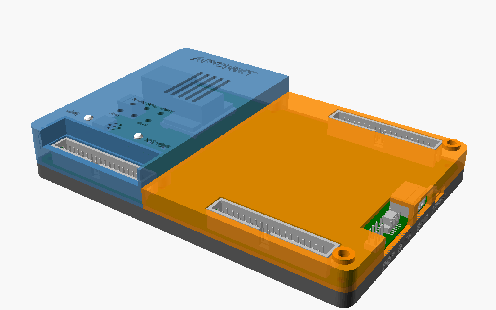

# Enclosure

First iteration of the printed enclosure, in OpenSCAD. Design decisions: [architecture.md, Enclosure](../../docs/architecture.md).

## Parts

| Part | Prints | Hardware |
|---|---|---|
| `bottom` | floor down | 6 × ISO 7380 M3 button head, from below |
| `host` (host-end lid) | top face down | 4 × Ruthex M3 × 5.7 inserts (H1, H4, H5, H6); 6 × Bivar PLP2-625 light pipes |
| `target` (target-end lid) | top face down | 4 × Ruthex M3 × 4.0 inserts (H2, H3: enclosure screw from below, shield screw from above) |
| `plunger` | standing, × 2 | |

Screws: M3 × 10 at H1 and H4, M3 × 12 at H5 and H6 (bottom, board, target lid tab, host lid), M3 × 8 at H2 and H3 from below; the shield takes M3 × 6 from above into H2 and H3.

Assembly: board into the bottom; target lid on, its two tabs on the board at H5 and H6; host lid on, over the tabs; six screws from below.

## Files

- `geom.py` (KiCad's Python): reads `../kicad/archet.kicad_pcb`, writes `board.scad` (hole positions, part boxes and heights) and `board.stl`, `parts.stl` (board and the parts the enclosure deals with, for the assembly view). Run it after any board change.
- `enclosure.scad`: the model. `-D 'PART="host"'` selects a part (`bottom`, `host`, `target`, `plunger`, `assembly`, `check`).
- `build.py`: writes `out/*.3mf` and `out/*.png`. `--check` intersects every shell with each part body from `board.scad` and fails on any overlap (about 10 minutes with OpenSCAD 2021).

Frame: the board frame of `hardware/gen/board.py` (x from the host edge, y down) drawn as (x, −y), z = 0 on the board's underside.

## Open points

- The check covers the parts listed in `geom.py`; the rest of the board is not placed yet. After placement, check every part against the lid ceilings (7.4 mm under the target lid) and keep the tab and column footprints at H5 and H6 free.
- Test prints: light pipe press fit (2.92 mm hole), plunger guide play (3.8 mm plunger in a 4.1 mm hole, 9 mm guide), USB-C and RJ45 openings, insert holes.

Plungers, light pipes and buzzer holes sit on the footprint origins exported by `geom.py`, not on the fab outline centres: the TS-1187A fab outline is 1 mm off its actuator, and an off-axis plunger would tilt in its guide.
- Insert lengths to match the stock.
